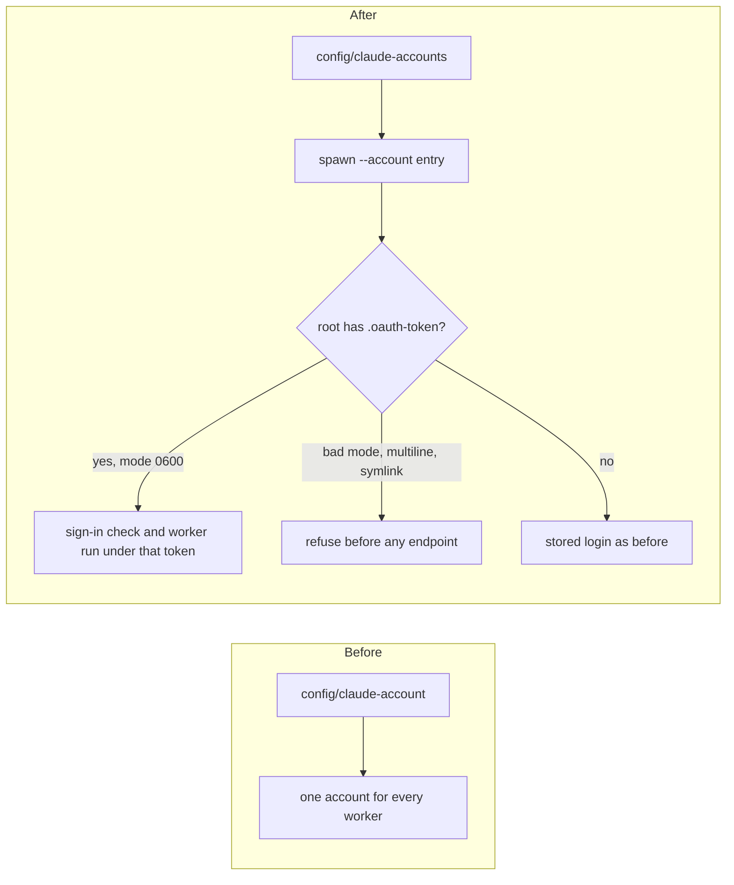

Before: one pinned Claude account per home, and a `claude setup-token` account could not be launched, checked, or measured.
After: `config/claude-accounts` lists accounts, each spawn names one with `--account`, and a root holding `.oauth-token` launches under its own token.



Test transcript:

```text
ok - a declared account named with --account is checked, launched, and recorded like a pin
ok - a setup-token root signs in under its own token, and only its worker receives it
ok - an unusable token file refuses before any endpoint exists, without echoing the token
ok - a rejected setup token refuses naming its file, never the token
ok - a setup-token root is read under its token and cached
ok - a refused token file is uncertainty and never read
ok - a Keychain root is read without the file-only flag
```
