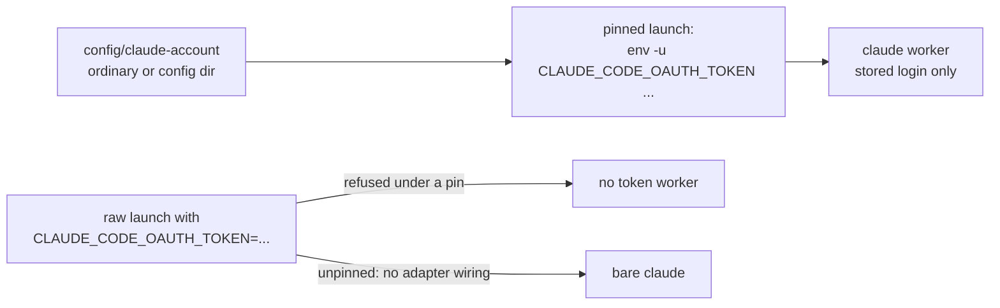
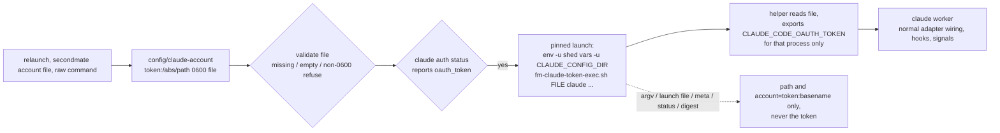

# Claude setup-token worker pin: before and after

## Before

## After

## Test evidence

`tests/fm-worker-account.test.sh`: `# all fm-worker-account tests passed`, including the five new `test_token_pin_*` and relaunch/helper cases, each scanning every record for the token sentinel.
