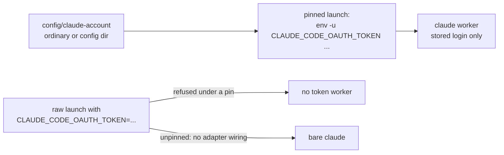
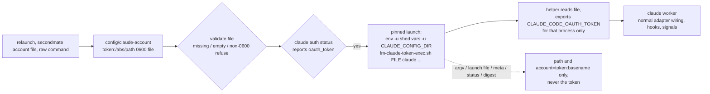

# Claude setup-token worker pin: before and after

## Before

## After

## Test evidence

`tests/fm-worker-account.test.sh`: `# all fm-worker-account tests passed`, including the five new `test_token_pin_*` and relaunch/helper cases, each scanning every record for the token sentinel.

## Verified vs not (internals parity with a standard Claude account)

Verified by tests (fake token and fake claude, no real credential):

- spawn, raw-command spawn, relaunch pre-stop check, per-secondmate pin, and the `account=token:<basename>` field on the spawned line and in the task record
- adapter wiring, hooks and settings are untouched: the token form only changes the env prefix of the launch, and `CLAUDE_CONFIG_DIR` is unset exactly as for `ordinary`, so the trust store, transcript lookup and warm-compact paths resolve to the same `~/.claude` as a standard account
- no token value in argv, launch file, task record, status, or inbox (sentinel scan)
- digest, session-start, teardown and crew-state code never read the pin, so they behave identically

Not verified:

- a real worker on a real setup-token (needs the captain's pin and token file)
- remote secondmates: the pin must exist in the remote home and the token file on that host
- dispatch ranking by quota: quota-axi 0.1.60 has no distinct accountKey for a token credential, and `quota_lane` has no pin awareness. Mapping the lane now would rank the token account on the ambient account's `default` row, which is wrong data, so it is left out. A dispatch-profile rule can still prefer the token account's candidate first.

## Live test plan (after the captain sets the pin)

1. Pin: `printf 'token:%s\n' ~/.config/claude-tokens/<acct>.token > config/claude-account`.
2. Check: `bin/fm-spawn.sh` of a trivial scout prints `account=token:<acct>.token`; confirm the worker answers a one-line prompt and `claude auth status` in its pane reports `oauth_token`.
3. Signals: confirm status events, idle and done detection, hooks and settings wiring fire as for a standard worker.
4. Recovery: `bin/fm-control.sh <id> relaunch` returns to the same account; then `exit` and teardown.
5. Secondmate: repeat with a per-secondmate file.
6. Leak scan: grep the task record, status, launch file, digest and process list for the first 12 characters of the token.
