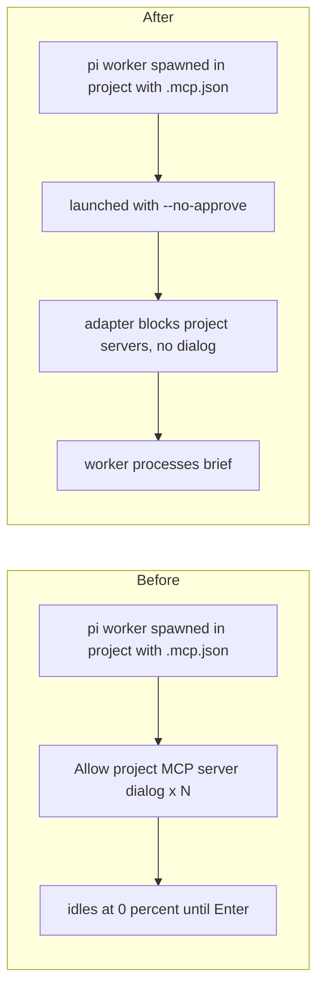

Verified in a throwaway project with `pi --tui-mode regular`: without the flag the dialog appears; with `--no-approve` the pane shows "MCP: 1 server enabled (1 blocked by project trust)" and the server never started.
