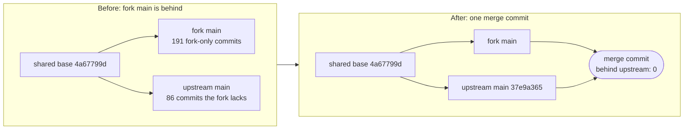

# Fork catches up with upstream

The fork's main was 86 upstream commits behind.
This merge makes upstream's main an ancestor of the fork again.

## What the check shows

| Check | Result |
| --- | --- |
| Commits upstream has that this branch lacks (`git rev-list --count HEAD..upstream/main`) | 0 |
| Files that conflicted | 47 |
| Conflict markers left in the tree | none |
| `bin/fm-lint.sh` | clean |
| `bin/fm-doc-audience-check.sh` | ok |
| `bin/fm-test-run.sh --check-coverage` | ok, 12 serial shards |
