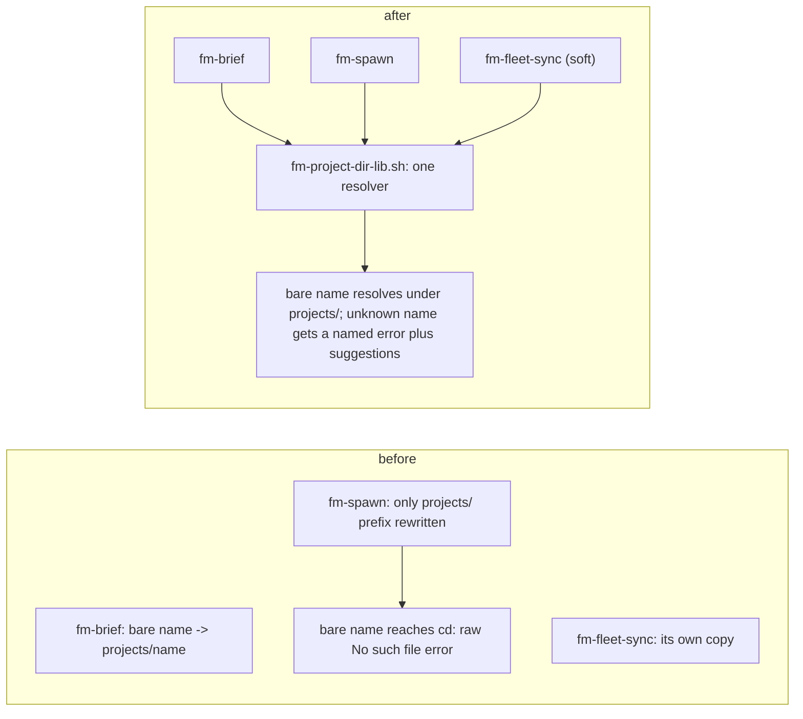

# Port of the kun P2 items

## Group 1: bare project name (ported)

Proof: `tests/fm-project-dir.test.sh` (7 cases), plus the existing fm-brief, fm-fleet-sync, fm-spawn-batch, and fm-spawn-project-match suites all pass.

## Group 2: idle-task surfacing (not ported, with reasons)

| kun commit | Decision | Reason |
| --- | --- | --- |
| e8279125 staleness auto-close | skipped | Its unlanded-work path kills the worker's chat process on idle. That is the behavior this port must never add. Its landed-work path is already main's `fm-reap.sh` LANDED class. |
| 09ec924b dead-window orphans | skipped | Main already surfaces them: `wedge_dead_record` in `bin/fm-watch.sh` raises one `stale:` wake per dead endpoint whose text says to check for unlanded work, and `fm-reap.sh` classes the record DEAD-UNLANDED (report-only when dirty, one relaunch when clean, escalation after that). |
| 8621c6d8 live pane focus guard | skipped | It only guards the auto-close reap from e8279125, which is not being ported. Main's reap never touches a live endpoint. |
