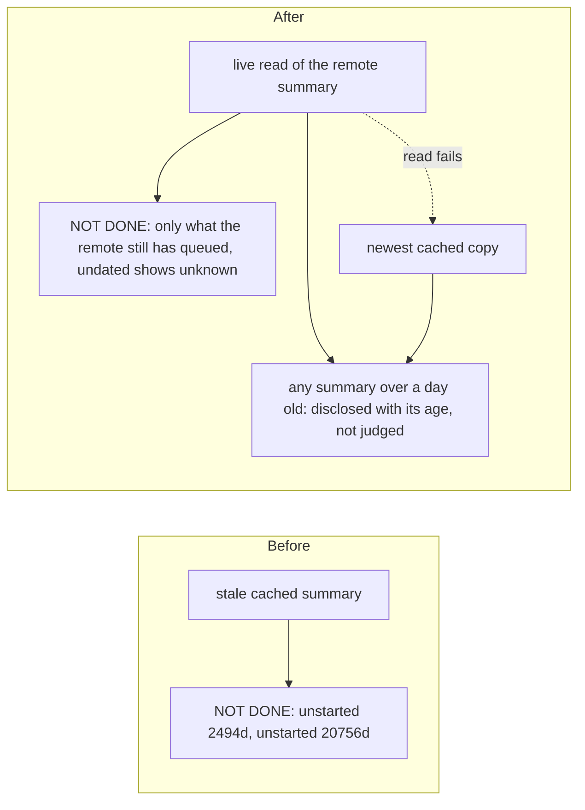

# NOT DONE shows remote-secondmate work the remote already closed

Fixture: a registered remote secondmate whose parent-side cached summary still lists two queued items, while the remote's live summary has already closed one of them; the other has no recorded date.



## Before (main)
```
Not done: Sidecar heartbeat persist (sidecar-heartbeat-persist-q1 on mini1-ops) - unstarted 20756d: queued with no dependency or date gate and never dispatched - firstmate: dispatch it, or ask the captain whether to drop it
Not done: Pre-push git env leak (fm-hooks-prepush-git-env-leak on mini1-ops) - unstarted 2494d: queued with no dependency or date gate and never dispatched - firstmate: dispatch it, or ask the captain whether to drop it
```

## After (this branch)
```
Not done: Sidecar heartbeat persist (sidecar-heartbeat-persist-q1 on mini1-ops) - unstarted unknown: queued with no dependency or date gate and never dispatched - firstmate: dispatch it, or ask the captain whether to drop it
```
