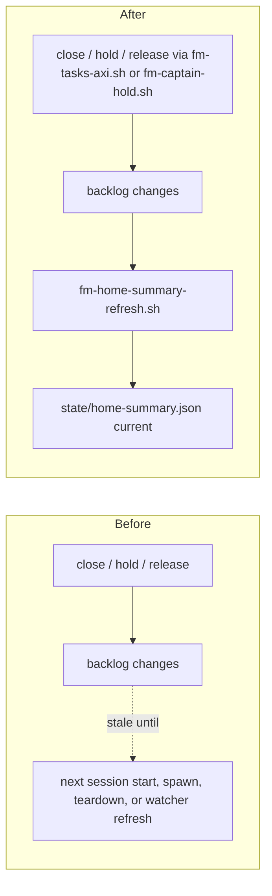

# Backlog changes republish the home summary



Transcript from the new test (`tests/fm-home-summary-refresh.test.sh`):

```
ok - holding a backlog item republishes the home summary
ok - releasing a backlog item republishes the home summary
ok - closing a backlog item republishes the home summary
ok - read-only backlog commands do not republish the home summary
ok - a failed republish warns and keeps the backlog change
ok - captain hold and answer republish the home summary
ok - captain reconcile close republishes the home summary on a post-close failure
```

Without the change the same test stops at `not ok - a hold did not reach the published ledger`.
