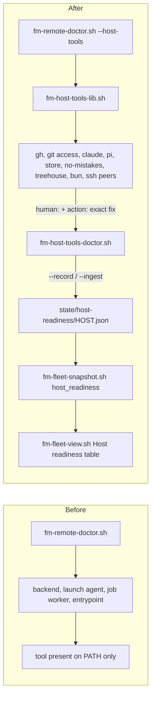

# Host readiness doctor: before -> after



Real output of `fm-fleet-view.sh` after recording a host that lacks gh auth (the m1studio1 case):

```
## Host readiness
| Host | Ready | Failing checks | Fix | Checked |
| --- | --- | --- | --- | --- |
| m1studio1 | NO | host-gh | gh auth login | 2026-11-16T19:37:53Z |
```
