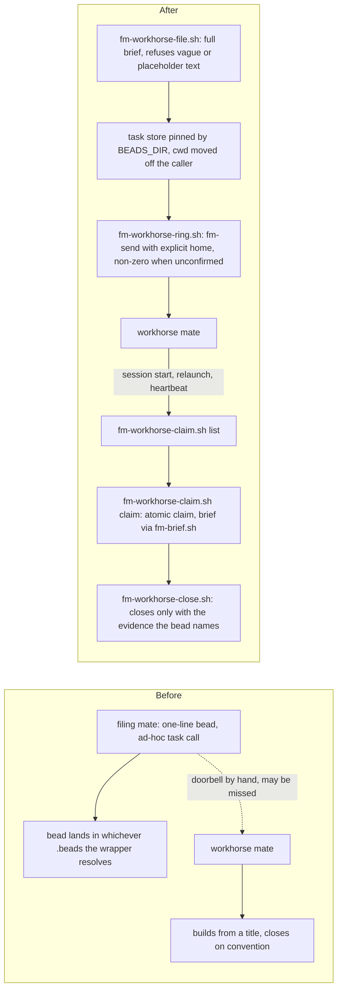

# Workhorse flow: before and after



## Test output

```
[file] 1..9
[file] ok - empty, vague, one-line, placeholder, labelled, and heading-splitting sections are refused with nothing filed
[file] ok - missing or invalid evidence, mode, yolo, project, and filing mate are refused with nothing filed
[file] ok - an absent pinned store is refused rather than replaced by the cwd's store
[file] ok - a valid request files one full-brief bead with label and filing mate in the pinned store
[file] ok - filing from a cwd holding another .beads reaches only the pinned task store
[file] ok - filing rings the workhorse through fm-send with an explicit home
[file] ok - a lost doorbell exits 4 after printing the filed bead id
[file] ok - dry-run prints the body and touches neither the store nor the mate
[file] ok - @file section text is read, and a missing file is refused
[file] FM_TEST_COMPLETE
[ring] 1..5
[ring] ok - the ring is one routed line through fm-send to the mate with FM_HOME explicit
[ring] ok - FM_WORKHORSE_HOME and FM_WORKHORSE_MATE select the home and mate
[ring] ok - an unconfirmed send exits 3 and says so
[ring] ok - refused rings send nothing: no home, bad id, absent bead, unlabelled bead, absent store
[ring] ok - the ring's bead lookup is pinned to the task store regardless of cwd
[ring] FM_TEST_COMPLETE
[claim] 1..8
[claim] ok - list reports an empty queue plainly
[claim] ok - list shows unclaimed workhorse beads, flags incomplete briefs, and skips claimed or unlabelled ones
[claim] ok - claim refusals (incomplete, unlabelled, absent, bad flags, no home, no store) leave beads untouched
[claim] ok - claim takes the oldest unclaimed full brief, claims it, and seeds the worker brief from it
[claim] ok - a claimed bead cannot be claimed again
[claim] ok - a lost claim race exits 5 and a store failure exits 1, both leaving no brief
[claim] ok - a failed scaffold gives the bead back
[claim] ok - every store call ran from the pinned store's parent with its BEADS_DIR
[claim] FM_TEST_COMPLETE
[close] 1..8
[close] ok - close refuses until every evidence kind the bead names is supplied
[close] ok - close refuses malformed PR links, token or missing output, and missing or empty reports
[close] ok - close refuses unclaimed, unlabelled, evidence-less, absent, and badly addressed beads
[close] ok - close with the named evidence comments it, closes with a reason, and names the answer-to mate
[close] ok - a bead naming a report closes on that report
[close] ok - an already closed bead is refused
[close] ok - a failed close after the evidence comment is reported with the retry
[close] ok - close reaches only the pinned task store
[close] FM_TEST_COMPLETE
```
