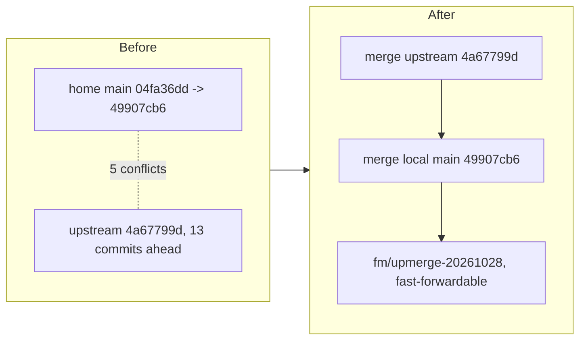

# upmerge 20261028: upstream 4a67799d into home main

| File | Resolution |
| --- | --- |
| .github/workflows/ci.yml | took upstream's TAP-plan verifier steps; home counts now live in the suite plans; serial matrix 10 -> 11 shards |
| bin/fm-test-run.sh | union of family lists and hints (home reap/meta-index plus upstream triage split, read-repetition); PORTABLE_SERIAL_SHARDS 10 -> 11 because the merged lane exceeded the 1200000 ms per-shard target |
| docs/configuration.md | union of both index rows (warm-cache compaction plus herdr tab labels) |
| tests/fm-fleet-snapshot-view.test.sh | kept home's 3 added tests, registered in upstream's fm_test_run (21 planned, 21 ok) |
| tests/fm-watch-triage.test.sh | took upstream's 3-file split; ported home's inbox-note, heartbeat-reap and hash_text tests into the main file, the parked-decision cap test into wedge-defer, and the terminal-repeat test plus the unheld-churn rewrite into pause |
