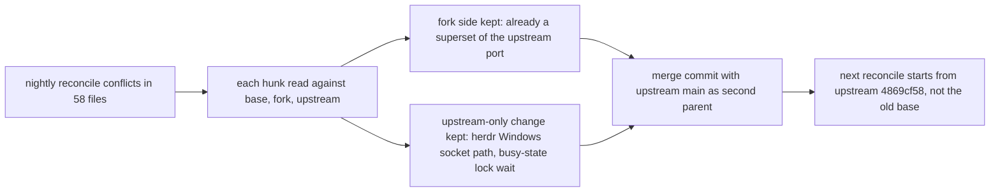

# Upstream reconcile 2026-11-05: conflict resolution record

Merges kunchenguid/firstmate main 4869cf58 (96 commits) into trillium/firstmate main 1e42851c.
Every one of the 58 conflicting files resolved to the fork's side, because the fork already carries a port of the upstream change in each conflicted region plus fork-only work on top of it.
Checked by comparing every conflict hunk three ways (base, fork, upstream) and then every upstream-added line against the merged file: no upstream-added line was lost except where the fork holds a deliberately different version, listed below.
Net effect on content: the merge adds upstream's Windows drive-letter socket canonicalization in the Herdr adapter, upstream's busy-state lock wait-until-stale fix, and their tests; everything else is unchanged from fork main.
The main gain is shared history, so the next nightly reconcile merges cleanly instead of conflicting on the same ports again.

## Per-file resolution

Legend: kept fork = took the fork side; combined = fork side plus an upstream line that was not in the fork.

### Per-launch `--account` (accepts a Claude account without `config/claude-accounts`)

Upstream's account list (4ee956ed) is already ported in the fork; upstream still refuses `--account` when no list is declared, so the fork is a strict superset.

- `bin/fm-spawn.sh` - kept fork. Usage text, parser, and relaunch carry the fork's `<value>` grammar; a duplicate parser branch the textual merge added was removed.
- `bin/fm-control.sh` - kept fork. Relaunch keeps a recorded `account_request` unless `--account` names another.
- `bin/fm-worker-account-lib.sh` - kept fork. Per-launch selection branch stays; a duplicated pair of list and relaunch helpers the merge produced was removed.
- `tests/fm-worker-account.test.sh` - kept fork. Upstream's "no list refuses `--account`" case contradicts the fork behavior and stays out.
- `tests/fm-spawn-dispatch-profile.test.sh` - kept fork (profile `account` grammar).
- `docs/agent-control.md`, `docs/configuration.md` - kept fork. Same grammar documented.

### Configurable remote second-mate Herdr session (`FM_REMOTE_HERDR_SESSION`)

Upstream pins the session to `fm-remote`; the fork reads the configured session and defaults to `default`.

- `bin/fm-remote-doctor.sh` - kept fork.
- `bin/fm-remote-secondmate-control.sh` - kept fork. Upstream's no-autostart export for Rex is present on both sides.
- `bin/fm-remote-entrypoint.sh` - kept fork. The pinned doctor checksum matches the unchanged fork doctor.
- `docs/remote-secondmates.md` - kept fork.
- `tests/fm-remote-secondmate-omp.test.sh` - kept fork.

### `fm-send --resolve-key` and captain holds (design difference, flagged)

Upstream feeds a firstmate steer that names a captain-held key into the keyed answer intake and closes the hold.
The fork (#296) refuses such a key, so a steer never records a captain answer.
The fork behavior is kept; upstream's feed function is not carried because nothing calls it.

- `bin/fm-send.sh` - kept fork.
- `bin/fm-captain-hold.sh` - kept fork. Completion record rewrite and summary republish both present.
- `docs/captain-hold-lifecycle.md` - kept fork.
- `tests/fm-send-resolve-key.test.sh` - kept fork.

### Dispatch resolver

- `bin/fm-dispatch-resolve.sh` - kept fork. Carries the opt-in question/answer log and the agy scope binding on top of upstream's explicit `quota_scope` row.
  Flag: upstream's `quota_scope` (043d8344) now covers pinning a model to a quota row explicitly, so the fork's model-name based agy binding is a candidate to drop.
- `.agents/skills/quota-array-dispatch/SKILL.md`, `docs/verification/dispatch-resolve.md`, `tests/fm-dispatch-resolve.test.sh`, `tests/fm-bootstrap.test.sh` - kept fork.

### PR base pinning and PR text

- `bin/fm-dod-lib.sh`, `bin/fm-brief.sh`, `bin/fm-promote.sh` - kept fork. Origin-repository pinning (#327) layered over upstream's `pr=manual` text.
- `tests/fm-task-delivery.test.sh`, `tests/fm-spawn-manual-pr-text.test.sh` - kept fork.

### Session lock, mutator enforcement, and merge

- `bin/fm-session-lock-lib.sh` - kept fork. Handover finishing posture and mutator refusal on top of upstream's ps-free identity read.
- `bin/fm-pr-merge.sh` - kept fork. The GitHub readiness checks live in `bin/fm-pr-github-ready-lib.sh` in the fork; upstream's single new line there (the expected-head refusal) is already in that library.
- `bin/fm-pr-lib.sh` - kept fork. Poll failures name their reason.
- `bin/fm-merge-local.sh`, `tests/fm-merge-local.test.sh` - kept fork. Observes the worker's done line before reading the pinned head (#319).
- `bin/fm-teardown.sh`, `tests/fm-teardown.test.sh` - kept fork. Exact patch-id match on the pushed branch counts as landed.

### Watcher, guards, backends

- `bin/fm-watch.sh` - kept fork. Pool lease tick, lane capacity publish, detached home summary, wedge escalation counter.
- `bin/fm-turnend-guard.sh`, `docs/turnend-guard.md`, `tests/fm-turnend-guard.test.sh`, `tests/fm-claude-stop-autoarm.test.sh` - kept fork (Pi guard mode next to Agy).
- `bin/fm-subagent-pretool-check.sh`, `docs/subagent-guard.md` - kept fork (Parlay-only Monitor allowance).
- `bin/fm-tmux-lib.sh` - kept fork (comment lists Agy as a shape owner).
- `bin/fm-backend.sh` - kept fork (adds the record-only cloud backend beside upstream's hc).
- `.agents/skills/harness-adapters/SKILL.md` - combined: upstream's Kiro and Hermes crewmate-only line plus the fork's Cloud runs section.
- `bin/fm-procevent-remote-reply.sh`, `bin/fm-review-diff.sh` - kept fork.
- `tests/fm-agy-harness.test.sh`, `tests/fm-kimi-harness.test.sh`, `tests/fm-backend-herdr.test.sh`, `tests/fm-control-relaunch.test.sh`, `tests/fm-send-kiro-confirm.test.sh`, `tests/fm-send-remote-delivery.test.sh`, `tests/fm-x-mode.test.sh` - kept fork. In `tests/fm-backend-herdr.test.sh` the upstream cygpath tests are added next to the fork's.

### CI and docs

- `.github/workflows/ci.yml`, `bin/fm-test-run.sh`, `CONTRIBUTING.md`, `docs/fm-test-portable-shards.md` - kept fork: four lint partitions, twelve serial shards, configurable macOS runner, and the matching shard lists.
- `docs/architecture.md`, `docs/scripts.md` - kept fork (extra reaper and script rows).

## Upstream-only changes taken

- `bin/backends/herdr.sh` plus three cygpath cases in `tests/fm-backend-herdr.test.sh`: Windows drive-letter socket paths compare equal to their POSIX spelling.
- `bin/fm-busy-event.sh` plus four cases in `tests/fm-busy-state.test.sh`: a busy-state writer waits until a lock can have reached the stale bound before refusing.

## Candidates for the creature review

- `fm-send --resolve-key` refusing captain-held keys: opposite of upstream, so it will conflict on every upstream change near that code.
- Agy model-name quota binding in the dispatch resolver: overlaps upstream's explicit `quota_scope`.
- Per-launch `--account` without a list: upstream refuses it; keep only if still used.
