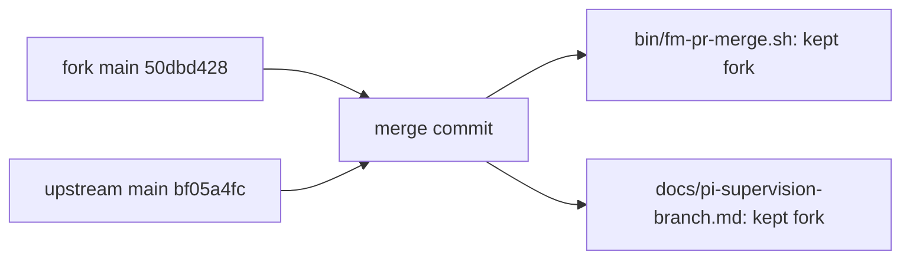

Upstream kunchenguid/firstmate main bf05a4fc merged into the fork.

- bin/fm-pr-merge.sh: kept fork. The fork already carries upstream's update-branch and settled-check logic, moved into bin/fm-pr-github-ready-lib.sh; the update function matches upstream's byte for byte, and the only differences are the fork's session-lock and ready-lib sourcing.
- docs/pi-supervision-branch.md: kept fork. Its fm-spawn row names the live-workers count, which fm-spawn.sh implements; upstream's row is the older wording.
