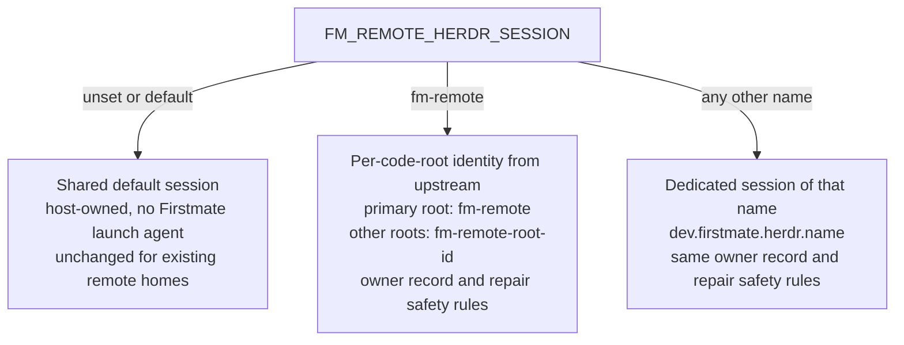

# Remote Herdr session after the upstream merge

`FM_REMOTE_HERDR_SESSION` now picks one of three modes, and an unset value keeps today's behavior.



Command output from the new identity test (`tests/fm-remote-herdr-identity.test.sh`):

```
ok - A a second code root launches, routes, and reads its mate in its own Herdr session
ok - B a second code root refuses an endpoint in the primary session
ok - C the owning code root keeps the primary fm-remote session
ok - D the parent accepts only the primary or a code-root-derived session
ok - E legacy ownership decodes spaces, apostrophes, and backslashes without changing service identity
ok - F the setting selects the host-owned, managed, or custom identity, and the parent accepts only what it can produce
ALL TESTS PASSED
```
