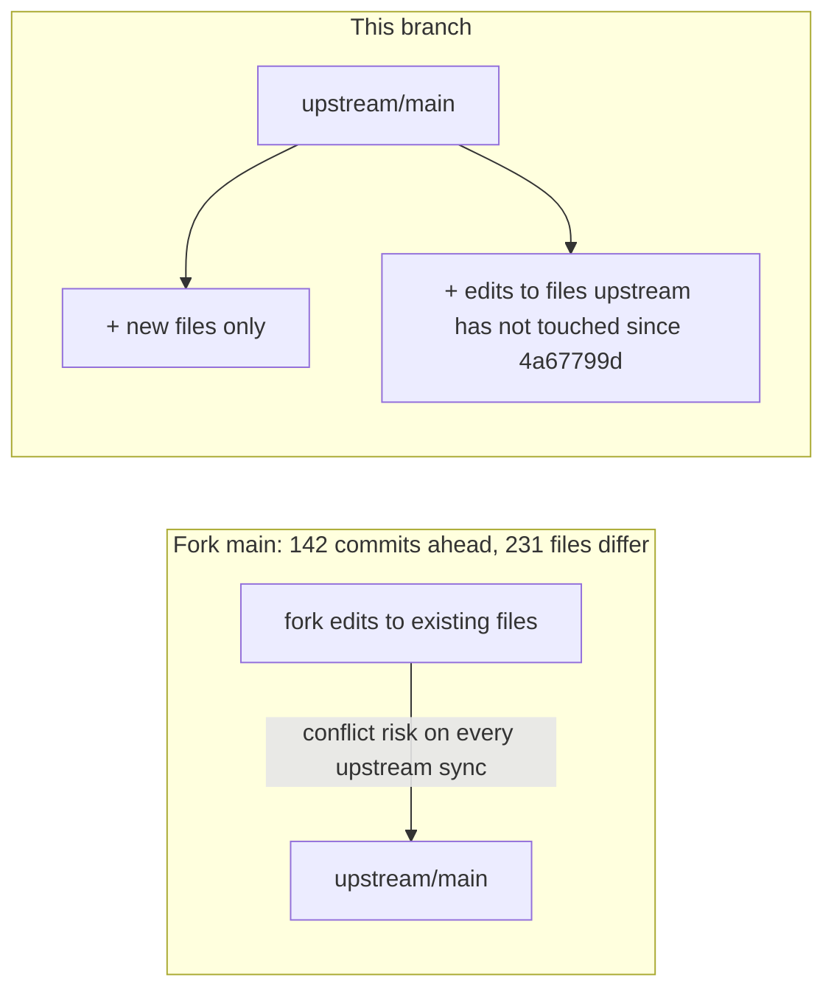

# Evidence: upstream-safe-branch



Verification transcript (summary):

```
$ git merge --no-commit --no-ff upstream/main
Already up to date.
$ git diff upstream/main --stat | tail -1
 95 files changed (adds + clean edits only)
test run: 293 scripts; remaining failures also fail on a pristine upstream/main copy
          (macOS md5/-q and /tmp path noise) or pass on re-run (load-sensitive timing).
```
